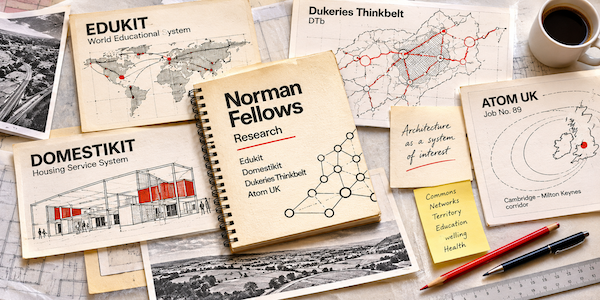

## Research

  

---

### About Norman Fellows :

Continuously involved in Anticipatory Design (AD) 
- Academic qualifications: MA (Open), Dip Arch (Leeds) :telescope: 
  
- Architectural practice founded: 1972 :seedling: 
  
- <a href="https://normanfellows.github.io/">Independent research</a>: initiated 1967 :zap: 

- Further information: Archiblog :mailbox:

&nbsp;&nbsp;

<!--
**Archiblog/Archiblog** is a ✨ _special_ ✨ repository because its `README.md` (this file) appears on your GitHub profile.

Here are some ideas to get you started:

- 🔭 I’m currently working on ...
- 🌱 I’m currently learning ...
- 👯 I’m looking to collaborate on ...
- 🤔 I’m looking for help with ...
- 💬 Ask me about ...
- 📫 How to reach me: ...
- 😄 Pronouns: ...
- ⚡ Fun fact: ...
-->
